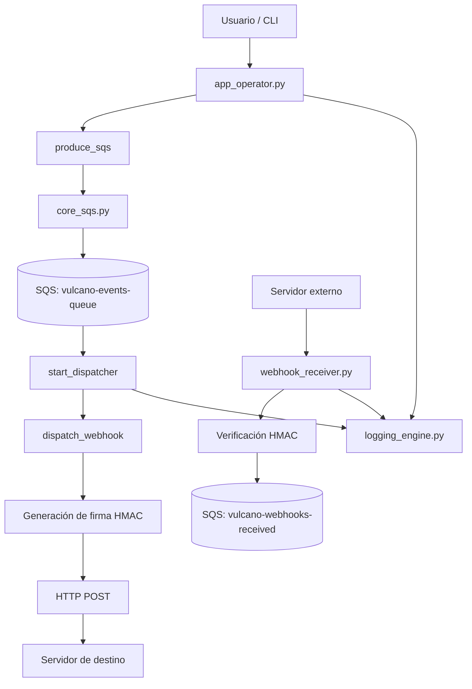

# Vulcano Pay — Sistema de Procesamiento de Eventos y Webhooks

## 1. Descripción del proyecto

**Vulcano Pay** es un sistema de procesamiento asíncrono de eventos que utiliza Amazon SQS mediante Boto3 y LocalStack para simular servicios de AWS en un entorno local.

El proyecto permite publicar eventos en colas, procesarlos de forma asíncrona y realizar entregas de webhooks protegidas mediante firmas criptográficas HMAC.

También incorpora mecanismos de validación, manejo de excepciones y observabilidad mediante un sistema de logging asíncrono con salida estructurada en formato JSON.

## 2. Objetivos

- Implementar un sistema de mensajería asíncrona utilizando Amazon SQS.
- Simular los servicios de AWS mediante LocalStack.
- Procesar y distribuir eventos mediante webhooks.
- Proteger las comunicaciones utilizando firmas HMAC.
- Validar los datos recibidos y sanitizar las entradas.
- Implementar manejo de errores y reintentos de entrega.
- Registrar las operaciones mediante logging estructurado y asíncrono.
- Incorporar pruebas para verificar el funcionamiento del sistema.

## 3. Tecnologías utilizadas

| Tecnología | Función |
|---|---|
| Python 3.14 | Lenguaje principal |
| Boto3 | Comunicación con los servicios de AWS |
| LocalStack | Simulación local de servicios AWS |
| Amazon SQS | Procesamiento y almacenamiento de mensajes |
| FastAPI | Implementación del receptor de webhooks |
| Uvicorn | Servidor ASGI |
| Requests | Envío de solicitudes HTTP |
| HMAC-SHA256 | Firma y verificación de mensajes |
| Asyncio | Ejecución de operaciones asíncronas |
| Pytest | Ejecución de pruebas |

## 4. Arquitectura del sistema

El sistema cuenta con dos flujos principales:

1. **Envío de eventos:** el usuario publica un evento mediante la CLI. El evento se almacena en una cola SQS y luego el dispatcher lo consume para enviarlo a un destino mediante un webhook firmado.
2. **Recepción de webhooks:** el receptor recibe una solicitud HTTP, verifica su firma HMAC y publica el evento validado en una segunda cola SQS.

### Diagrama de arquitectura



Las colas `vulcano-events-queue` y `vulcano-webhooks-received` cumplen funciones diferentes: la primera recibe los eventos producidos desde la CLI y la segunda almacena los webhooks recibidos y validados.

## 5. Componentes principales

### app_operator.py

Es el punto de entrada y operador principal de la aplicación.

Sus responsabilidades son:

- Construir la interfaz de línea de comandos utilizando `argparse`.
- Publicar eventos en SQS.
- Iniciar el servidor receptor de webhooks.
- Iniciar el dispatcher encargado de consumir mensajes.
- Generar y enviar webhooks firmados mediante HMAC.
- Manejar excepciones y garantizar el cierre ordenado del sistema de logging.

La CLI dispone de tres comandos principales:

- `produce-sqs`: publica eventos en una cola SQS.
- `start-receiver`: inicia el servidor receptor de webhooks.
- `start-dispatcher`: inicia el procesamiento y envío de eventos.

### core_sqs.py

Contiene la lógica de comunicación con Amazon SQS mediante Boto3.

Sus responsabilidades incluyen:

- Crear el cliente de SQS.
- Obtener las URL de las colas.
- Enviar mensajes.
- Recibir mensajes mediante long polling.
- Gestionar la comunicación con LocalStack.

### webhook_receiver.py

Implementa el servidor receptor mediante FastAPI.

El endpoint principal es:

`POST /webhook`

Sus responsabilidades son:

- Recibir solicitudes HTTP.
- Obtener la firma enviada en la cabecera `X-Webhook-Signature`.
- Verificar la autenticidad del mensaje.
- Validar el contenido recibido.
- Publicar los eventos aceptados en la cola `vulcano-webhooks-received`.

El secreto utilizado para verificar las firmas se configura mediante la variable de entorno `WEBHOOK_SECRET`.

### webhook_crypto.py

Contiene la lógica criptográfica utilizada para generar y verificar firmas HMAC.

Permite comprobar la integridad y autenticidad de los mensajes transmitidos mediante webhooks.

### sanitizer.py

Contiene funciones de validación y sanitización de entradas para evitar que datos incorrectos lleguen a los componentes internos del sistema.

### exceptions.py

Define las excepciones personalizadas utilizadas para identificar errores específicos del sistema, entre ellas:

- `VulcanoError`
- `SQSConnectionError`
- `QueueTimeoutError`
- `CorruptedMessageError`
- `WebhookSignatureError`
- `WebhookTimestampError`
- `WebhookDeliveryError`

### logging_engine.py

Implementa el sistema de observabilidad y registro de eventos.

Características principales:

- Logging estructurado en formato JSON.
- Procesamiento asíncrono mediante `QueueHandler` y `QueueListener`.
- Escritura de registros en archivos.
- Rotación automática de logs.
- Compresión de archivos antiguos mediante GZIP.
- Registro de información como fecha, nivel, mensaje y datos de contexto.

## 6. Requisitos previos

Antes de ejecutar el proyecto se necesita:

- Python 3.14 o una versión compatible con las dependencias utilizadas.
- Docker Desktop.
- LocalStack en ejecución.
- Git.
- Las dependencias indicadas en `requirements.txt`.

## 7. Instalación

Clonar el repositorio:

```bash
git clone https://github.com/SantiS156/vulcano_engine.git
```

Ingresar al directorio:

```bash
cd vulcano_engine
```

Crear un entorno virtual:

```bash
python -m venv venv
```

Activar el entorno virtual en Windows PowerShell:

```powershell
.\venv\Scripts\Activate.ps1
```

Instalar las dependencias:

```bash
pip install -r requirements.txt
```

## 8. Configuración de LocalStack

LocalStack permite simular servicios de AWS de manera local, evitando la necesidad de utilizar una cuenta real de AWS para el entorno de desarrollo.

El servicio SQS utiliza como endpoint:

```text
http://localhost:4566
```

La región configurada es:

```text
us-east-1
```

Las credenciales utilizadas corresponden al entorno local de pruebas.

### Verificar el estado de LocalStack

```powershell
curl.exe http://localhost:4566/_localstack/health
```

Se debe comprobar que el servicio SQS se encuentre disponible.

### Colas utilizadas

El proyecto utiliza las siguientes colas:

- `vulcano-events-queue`: recibe los eventos publicados por la CLI.
- `vulcano-webhooks-received`: almacena los webhooks recibidos y validados.

Ambas colas deben existir antes de ejecutar las operaciones correspondientes.

Para habilitar el redireccionamiento de mensajes fallidos, también se debe configurar una Dead Letter Queue (DLQ) y su política de redireccionamiento en SQS.

## 9. Ejecución del proyecto

Los comandos deben ejecutarse desde el directorio raíz del repositorio, con el entorno virtual activado y LocalStack en funcionamiento.

### 9.1 Publicar un evento en SQS

```powershell
python -m src.vulcano_telemetry.app_operator produce-sqs --message "{\"evento\":\"pago_aprobado\"}"
```

Este comando publica un evento de prueba en la cola principal.

### 9.2 Iniciar el receptor de webhooks

En una terminal de PowerShell:

```powershell
$env:WEBHOOK_SECRET="CAMBIAR_POR_UN_SECRETO"
```

Luego ejecutar:

```powershell
python -m src.vulcano_telemetry.app_operator start-receiver
```

El servidor receptor estará disponible en:

```text
http://127.0.0.1:8000/webhook
```

### 9.3 Iniciar el dispatcher

En otra terminal, ejecutar:

```powershell
python -m src.vulcano_telemetry.app_operator start-dispatcher --target-url "http://127.0.0.1:8000/webhook" --secret "CAMBIAR_POR_UN_SECRETO"
```

El dispatcher consume eventos de la cola principal y los envía al destino configurado mediante solicitudes HTTP firmadas.

**Importante:** el secreto utilizado por el dispatcher debe coincidir con el valor configurado en `WEBHOOK_SECRET` del receptor cuando se envían los eventos a ese receptor.

El dispatcher utiliza la cola principal y el receptor publica los mensajes aceptados en una cola diferente. De esta manera se evita que el mismo flujo procese indefinidamente sus propios mensajes.

## 10. Seguridad

El sistema incorpora mecanismos de seguridad para proteger la comunicación entre componentes:

- Firmas criptográficas HMAC-SHA256.
- Verificación de firmas recibidas.
- Validación de marcas de tiempo.
- Validación y sanitización de entradas.
- Manejo de excepciones específicas.
- Uso de variables de entorno para configurar secretos.

Los secretos utilizados en un entorno real deben mantenerse fuera del código fuente y no deben publicarse en el repositorio.

## 11. Manejo de errores y reintentos

El sistema utiliza excepciones personalizadas para identificar distintos problemas durante el procesamiento.

Entre los errores contemplados se encuentran:

- Fallas de conexión con SQS.
- Tiempo de espera de las colas.
- Mensajes corruptos.
- Firmas HMAC inválidas.
- Marcas de tiempo incorrectas.
- Errores durante la entrega de webhooks.

Cuando la entrega de un webhook falla, el mensaje no se elimina de la cola principal, permitiendo que SQS pueda volver a entregarlo según su configuración.

La Dead Letter Queue permite redireccionar mensajes que superan la cantidad de intentos configurada.

## 12. Observabilidad y logging

El sistema incorpora un motor de logging asíncrono para registrar las operaciones sin bloquear innecesariamente el procesamiento principal.

Los registros se almacenan en formato JSON e incluyen información contextual para facilitar el diagnóstico de errores.

También se implementa rotación de archivos y compresión GZIP para administrar el almacenamiento de logs.

El cierre del sistema de logging se realiza de manera ordenada para garantizar que los registros pendientes puedan procesarse.

## 13. Ejecución de pruebas

Para ejecutar las pruebas del proyecto:

```powershell
python -m pytest -v
```

Las pruebas permiten verificar distintos comportamientos del sistema, incluyendo:

- Procesamiento de eventos.
- Validación de mensajes.
- Manejo de errores.
- Verificación de firmas.
- Redireccionamiento de mensajes fallidos a la DLQ.

**Última ejecución registrada durante el desarrollo:** 5 pruebas aprobadas (`5 passed`). El resultado puede variar según el entorno y la configuración de LocalStack.

## 14. API pública del paquete

El archivo `src/vulcano_telemetry/__init__.py` define las excepciones disponibles para su importación desde el paquete.

Esto permite mantener una interfaz pública organizada y facilita la reutilización de las excepciones en otros módulos.

## 15. Repositorio

Proyecto desarrollado de manera colaborativa como parte del trabajo práctico de procesamiento de eventos, webhooks HMAC y observabilidad asíncrona.

**GitHub:**

https://github.com/SantiS156/vulcano_engine

---


## Integrantes del proyecto

- **Santiago Ezequiel Sosa**
- **Rocio Ayelen Lopez**
- **Mendez Mateo Joaquin**
- **Alex Cruz Vargas**
- **Joel Lamas**


**Proyecto Vulcano Pay**  
Sistema de Procesamiento de Eventos, Webhooks HMAC y Observabilidad Asíncrona.